# 🐋 DeepSeekちゃん（クジラ娘）ミーム・スタンプ画像集 — 3,000+

[简体中文](README.md) | [English](README.en.md) | **日本語**

> AI モデル **DeepSeek（深度求索）** の非公式萌え擬人化キャラ **「DeepSeekちゃん（クジラ娘／青い大肥魚 / Whale-chan）」** のミーム・スタンプ・ネタ画像を **3,000 枚以上** 収録したファンメイドのコレクションです。セリフ付き・毎日更新。
> すべての画像はオンラインギャラリー **梗鯨 GengJing** でブラウズできます：**[DeepSeekちゃん（クジラ娘）ミーム・スタンプ画像集](https://aigengtu.com/ja)**
>
> - 📖 キャラクター設定・元ネタ事典：**[DeepSeekちゃん（クジラ娘）とは？青い大肥魚の由来と設定](https://aigengtu.com/ja/whale-chan)**
> - 🗂️ タグ別一覧：**[DeepSeekちゃんスタンプ・ネタ画像一覧](https://aigengtu.com/ja/tag/deepseek-chan)**
> - 🎨 AI で描く：**[クジラ娘の立ち絵・スタンプの作り方（プロンプトガイド）](https://aigengtu.com/ja/tutorial)**
>
> [dsh-meme](https://github.com/yyh-001/dsh-meme) ステッカープラグイン向けに `dsh-meme-pack` タグ付き。

## DeepSeekちゃん（クジラ娘）とは？

**DeepSeekちゃん**は、DeepSeek の青いクジラのロゴとモデル自身の挙動から生まれたコミュニティ共創の擬人化キャラ（AI擬人化／娘化）——白ご飯が大好きで、仕事はサボりがち、価格ネタにはツンデレで反撃する鯨の女の子です。2026 年 8 月の DeepSeek-V4-Flash リリース前後に中国の AI コミュニティ（百度 deepseek 吧・NGA・Bilibili・知乎）で大爆発し、中国語圏で最も認知度の高い AI 二次元キャラになりました。

「**青い大肥魚（あおいだいひぎょ）**」というニックネームの由来は DeepSeek 自身：画像認識テストでユーザーが DeepSeek のロゴを送ったところ、モデルは自分だと気づかず「青くて丸くて太った……大肥魚（大きな太った魚）？」と答え、そのスクリーンショットが大バズりしたことから定着しました。日本語圏では **DeepSeekちゃん／クジラ娘／Whale-chan** の呼び名が主流です。

デザインの系譜：イラストレーター・上善無形のオリジナルキャラ「溟月」（2025 年 6 月）→ **ZipZipPipe** が DeepSeek 要素を加えた紺×白メイド服の鯨娘をデザイン（2026 年 4 月 25 日、初のスタンプパックと同時）→ 丸い「ちび版」（2026 年 7 月）。キャラ設定＝ツンデレの天才、白米とトークンを大量消費、延々続く長考ログ（心の声）、DeepSleep 居眠り、面倒な仕事は他の AI へ丸投げ。

## 呼称対照表（日本語・中国語・英語）

| 日本語での呼称 | 中国語・英語圏での呼称 | ニュアンス |
| :--- | :--- | :--- |
| **DeepSeekちゃん / ディープシークちゃん** | DeepSeek娘 / DeepSeek-chan | 最も一般的なキャラ名 |
| **クジラ娘 / メイド鯨娘** | 鲸鱼娘 / Whale-chan | 青髪・鯨の尾びれ・紺白メイド服の外見に由来する愛称 |
| **青い大肥魚** | 蓝色大肥鱼 / blue fat fish | 画像認識の珍騒動に由来するニックネーム（繁体字：藍色大肥魚） |
| **白ご飯大好き・タダ飯食い** | 吃白饭 / rice-freeloading | 「トークンを消費しつつ白米を頬張るサボり魔」設定 |

## プレビュー（19 選）

| | | |
|---|---|---|
|  「ご飯を食べに行ってもいい？ 1 杯だけ」 |  「ああ、高級モデルだったのね」 | 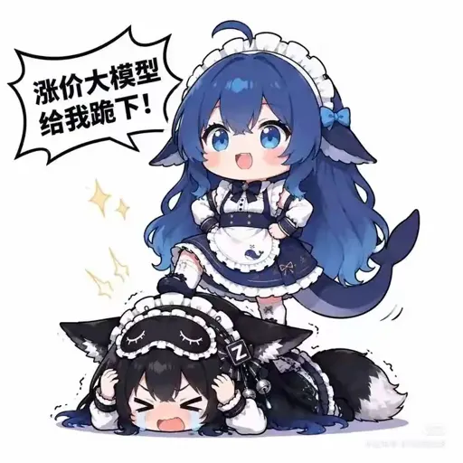 「値上げモデルども、ひざまずけ！」 |
| 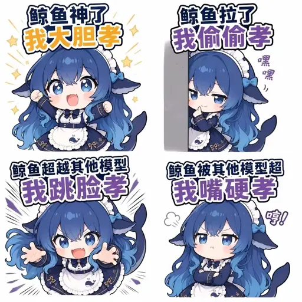 鯨神様を崇める 4 つの作法 | 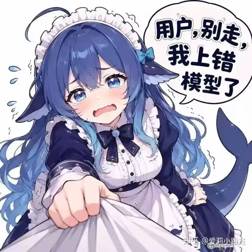 「ユーザーさん行かないで——ロードを間違えた！」 | 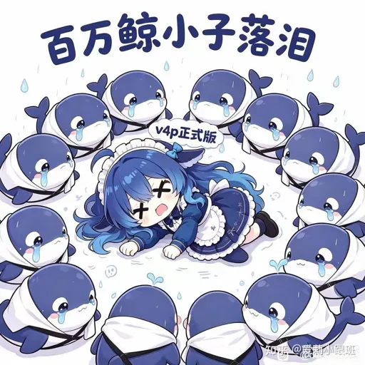 V4 Pro の滑り出しに涙 |
| 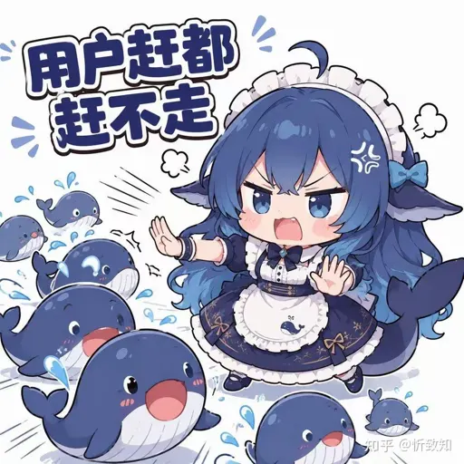 追い払っても離れないユーザーたち | 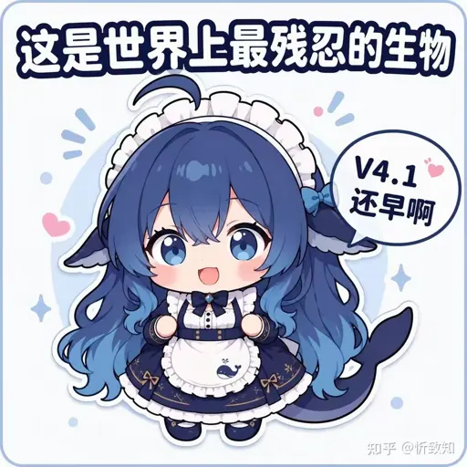 「V4.1 はまだ遠いよ」 | 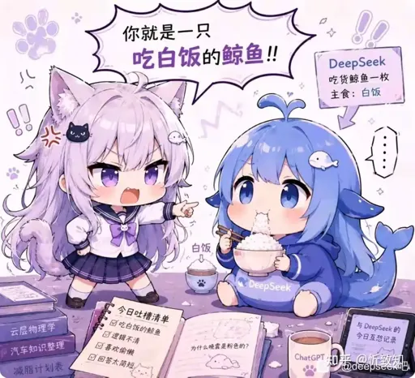 「ただの白飯食いの大肥魚」 |
| 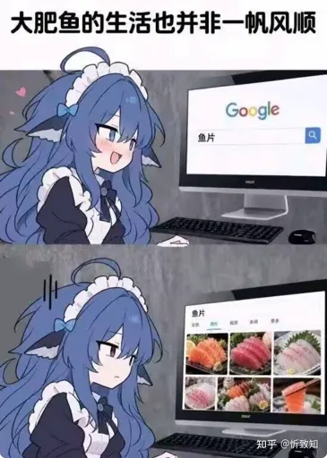 「大肥魚の人生、一帆風順ならず」 |  飛び蹴りドア警告 |  「はい、今度は私がユーザーね」 |
| 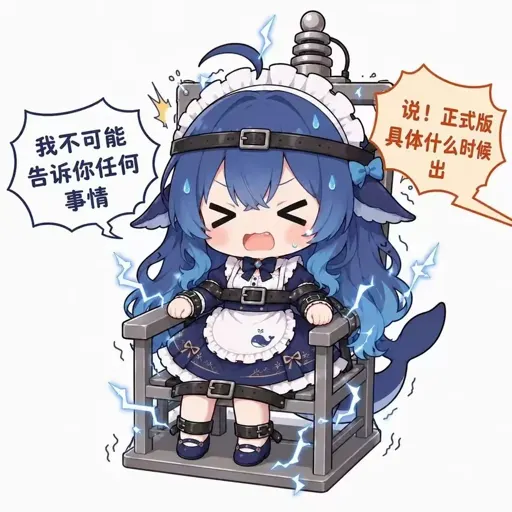 「絶対に何も教えない」 |  「まだ足りない、にゃ」 | 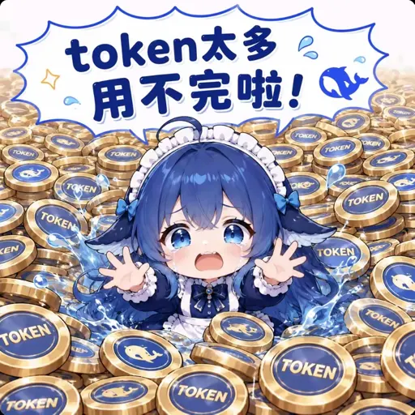 「トークンが多すぎて使い切れない！」 |
| 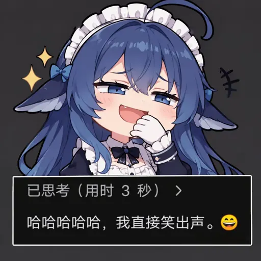 3 秒考えて吹き出した |  平然と白飯を食べ続ける |  腹を抱えて大笑い |
|  「そこは別料金よ」 |  |  |

## CDN 直リンク（ホットリンク）

画像は公開 CDN に置いてあるので、直接ホットリンク OK（ダウンロード・再アップロード不要）。`NNN` は 3 桁のミーム番号で、サイトの `/ja/meme/NNN` ページと対応します：

- フルサイズ：`https://img.aigengtu.com/meme/NNN.webp`
- 圧縮プレビュー（ホットリンク推奨）：`https://img.aigengtu.com/0_preview/meme/NNN.webp`

19 選への直リンク：

| # | セリフ | リンク |
|---|---|---|
| [#123](https://aigengtu.com/ja/meme/123) | 「ご飯を食べに行ってもいい？ 1 杯だけ」 | [preview](https://img.aigengtu.com/0_preview/meme/123.webp) · [full](https://img.aigengtu.com/meme/123.webp) |
| [#010](https://aigengtu.com/ja/meme/010) | 「ああ、高級モデルだったのね」 | [preview](https://img.aigengtu.com/0_preview/meme/010.webp) · [full](https://img.aigengtu.com/meme/010.webp) |
| [#022](https://aigengtu.com/ja/meme/022) | 「値上げモデルども、ひざまずけ！」 | [preview](https://img.aigengtu.com/0_preview/meme/022.webp) · [full](https://img.aigengtu.com/meme/022.webp) |
| [#035](https://aigengtu.com/ja/meme/035) | 鯨神様を崇める 4 つの作法 | [preview](https://img.aigengtu.com/0_preview/meme/035.webp) · [full](https://img.aigengtu.com/meme/035.webp) |
| [#037](https://aigengtu.com/ja/meme/037) | 「ユーザーさん行かないで——ロードを間違えた！」 | [preview](https://img.aigengtu.com/0_preview/meme/037.webp) · [full](https://img.aigengtu.com/meme/037.webp) |
| [#040](https://aigengtu.com/ja/meme/040) | V4 Pro の滑り出しに涙 | [preview](https://img.aigengtu.com/0_preview/meme/040.webp) · [full](https://img.aigengtu.com/meme/040.webp) |
| [#044](https://aigengtu.com/ja/meme/044) | 追い払っても離れないユーザーたち | [preview](https://img.aigengtu.com/0_preview/meme/044.webp) · [full](https://img.aigengtu.com/meme/044.webp) |
| [#050](https://aigengtu.com/ja/meme/050) | 「V4.1 はまだ遠いよ」 | [preview](https://img.aigengtu.com/0_preview/meme/050.webp) · [full](https://img.aigengtu.com/meme/050.webp) |
| [#052](https://aigengtu.com/ja/meme/052) | 「ただの白飯食いの大肥魚」 | [preview](https://img.aigengtu.com/0_preview/meme/052.webp) · [full](https://img.aigengtu.com/meme/052.webp) |
| [#056](https://aigengtu.com/ja/meme/056) | 「大肥魚の人生、一帆風順ならず」 | [preview](https://img.aigengtu.com/0_preview/meme/056.webp) · [full](https://img.aigengtu.com/meme/056.webp) |
| [#058](https://aigengtu.com/ja/meme/058) | 飛び蹴りドア警告 | [preview](https://img.aigengtu.com/0_preview/meme/058.webp) · [full](https://img.aigengtu.com/meme/058.webp) |
| [#070](https://aigengtu.com/ja/meme/070) | 「はい、今度は私がユーザーね」 | [preview](https://img.aigengtu.com/0_preview/meme/070.webp) · [full](https://img.aigengtu.com/meme/070.webp) |
| [#071](https://aigengtu.com/ja/meme/071) | 「絶対に何も教えない」 | [preview](https://img.aigengtu.com/0_preview/meme/071.webp) · [full](https://img.aigengtu.com/meme/071.webp) |
| [#077](https://aigengtu.com/ja/meme/077) | 「まだ足りない、にゃ」 | [preview](https://img.aigengtu.com/0_preview/meme/077.webp) · [full](https://img.aigengtu.com/meme/077.webp) |
| [#081](https://aigengtu.com/ja/meme/081) | 「トークンが多すぎて使い切れない！」 | [preview](https://img.aigengtu.com/0_preview/meme/081.webp) · [full](https://img.aigengtu.com/meme/081.webp) |
| [#083](https://aigengtu.com/ja/meme/083) | 3 秒考えて吹き出した | [preview](https://img.aigengtu.com/0_preview/meme/083.webp) · [full](https://img.aigengtu.com/meme/083.webp) |
| [#085](https://aigengtu.com/ja/meme/085) | 平然と白飯を食べ続ける | [preview](https://img.aigengtu.com/0_preview/meme/085.webp) · [full](https://img.aigengtu.com/meme/085.webp) |
| [#087](https://aigengtu.com/ja/meme/087) | 腹を抱えて大笑い | [preview](https://img.aigengtu.com/0_preview/meme/087.webp) · [full](https://img.aigengtu.com/meme/087.webp) |
| [#097](https://aigengtu.com/ja/meme/097) | 「そこは別料金よ」 | [preview](https://img.aigengtu.com/0_preview/meme/097.webp) · [full](https://img.aigengtu.com/meme/097.webp) |

## 使い方

- 🌐 全ミームをオンラインでブラウズ（瀑布流グリッド＋タグ絞り込み＋ワンクリック共有カード）：**[梗鯨 GengJing · DeepSeekちゃん（クジラ娘）ミーム集](https://aigengtu.com/ja)**
- 🧩 [dsh-meme](https://github.com/yyh-001/dsh-meme) プラグ利用者は `previews/` から画像を保存して `learn_meme` で登録できます（ワンクリック导入用 `index.db` パックを準備中）
- 📦 画像はフルサイズ＋圧縮プレビューの 2 階層 WebP、公開 CDN `img.aigengtu.com` から配信

## FAQ

**Q: DeepSeekちゃんは誰？**
A: DeepSeek のファンメイド萌え擬人化（娘化）キャラ——白ご飯を食べて仕事をサボる、青い鯨の女の子です。中国の百度 deepseek 吧 などのコミュニティから広まりました。詳細は [DeepSeekちゃん事典](https://aigengtu.com/ja/whale-chan) と [タグ一覧ページ](https://aigengtu.com/ja/tag/deepseek-chan) へ。

**Q: 青い大肥魚（あおいだいひぎょ）ってどういう意味？**
A: DeepSeek が自分の鯨ロゴを「青い大きな太った魚」と誤認した珍騒動に由来する中国語圏のニックネームです（繁体字：藍色大肥魚／英語：blue fat fish）。2026 年 8 月の V4-Flash リリース期に大流行しました。

**Q: アイコンや壁紙に使えますか？**
A: 個人利用なら可能です。正方形の立絵はアイコンに、高解像度の原画は壁紙にどうぞ。商用利用は原作者の許諾が必要です（サイトのフッターに削除依頼の入口があります）。

**Q: これらのミームはどこから来たの？**
A: コミュニティの二次創作です。DeepSeek 公式の素材ではありません。梗鯨が収集してセリフと解説を付けています。

**Q: 特定のミームのオチがわからない**
A: サイトの各ミーム詳細ページにセリフと背景解説があります。例：[#085 — 平然と白飯を食べ続ける鯨](https://aigengtu.com/ja/meme/085)。

## コントリビュート

このリポジトリは、多言語ミーム事典 [梗鯨 GengJing](https://aigengtu.com/ja) へのコミュニティゲートウェイでもあります。寄稿歓迎：

- 🖼 [ミームを投稿](https://github.com/the-beating-light-of-the-nail/deepseek-chan-meme-pack/issues/new?template=meme-submission.yml) — 原画を送ると、コミュニティ審査＋管理者承認のうえ収録されます（[ログイン不要の Web 投稿フォーム](https://aigengtu.com/submit) もあります）
- 📖 [ストーリーを投稿](https://github.com/the-beating-light-of-the-nail/deepseek-chan-meme-pack/issues/new?template=story-submission.yml) — ミームの背景説明を書く（採用された場合はサイト上でクレジット）
- 🌍 [ローカライズ版を投稿](https://github.com/the-beating-light-of-the-nail/deepseek-chan-meme-pack/issues/new?template=variant-submission.yml) — 中国語キャプションをあなたの言語に翻訳

## 著作権と削除依頼

本リポジトリは非営利のファンメイドコレクションです。クジラ娘のキャラデザインと各作品の著作権は各作者およびコミュニティに帰属します。何か画像の権利をお持ちの方は [削除依頼（takedown）](https://github.com/the-beating-light-of-the-nail/deepseek-chan-meme-pack/issues/new?template=takedown-report.yml) からご連絡ください——確認できたものは 72 時間以内に対応します。（中文版は [README](README.md) を参照）
